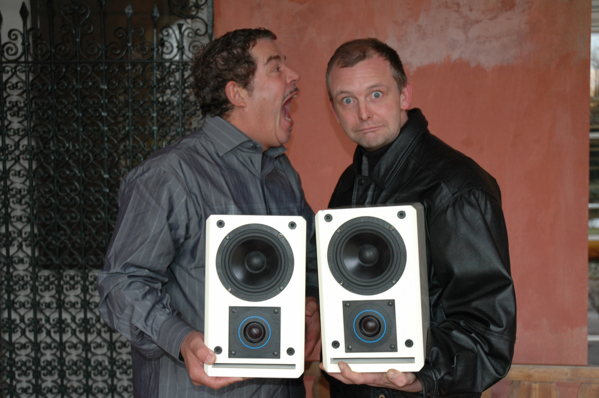

## Mijn connecties met Yello

Many years ago when I was developing the design for my speakers I often used the music by Yello for testing. One day when I was searching online for info about what Yello was up to I came across an info site for their manager.

So an idea came to me. I wondered what Boris Blank would make of my speakers. So after a few emails back and forth I arranged to send a set of my speakers to Zurich for Boris to have a listen. A few weeks later and to my complete surprise I got a phone call from Boris.

He was very complimentary about my design and the sound that came out such a relatively small speaker.

The conclusion to the story was that I got invited to visit him at the studio in Zurich. So one very cold January I arrive in Zurich and had the most amazing day with an audio magician.

He very kindly allowed me to takes some photos of him with my speakers for my website. He also signed the very first 12” record I bought of theirs

Such a wonderful experience I will never forget. Needless to say he used my speakers in his studio for many years.

To complete my day I even met Dieter and his comment about speakers was equally amazing –

> the Steinway of speakers
>
> — Dieter

So I give many thanks to the two amazing guys who are Yello.

