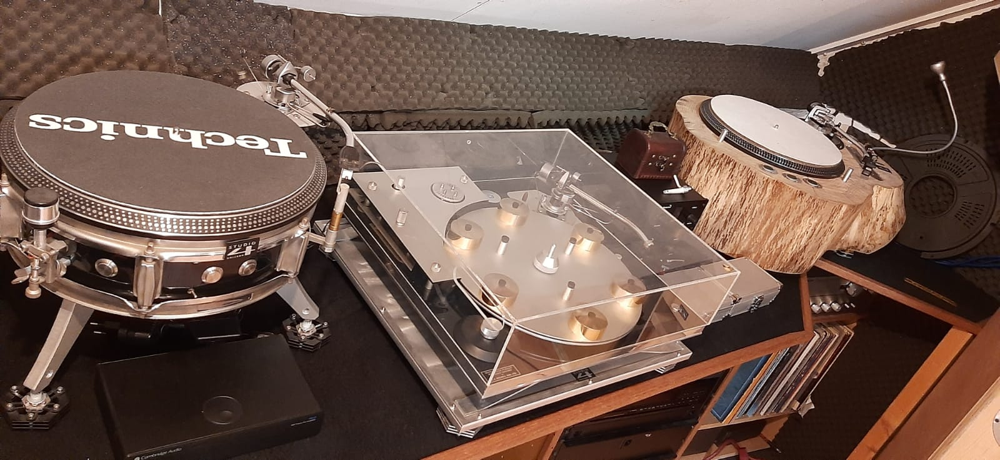

## Why and how did Studio 4 Holland get created.

Well It all started when I was about 10 years of age I guess.\
My Father encouraged me to have a go at building a matchbox size radio.

Then a few years later we built a set of speakers together, which turned out to be rather excellent.\
I ended up making some for friends.

The turntable obsession came a few years later after I discovered that mixing two records together was a constant musical journey.

Had my first set of SL1200 when I was 17. During this time I was a trainee at a local recording and video editing studio. Its only when I moved to London to further my Editing career that I discovered the vibrant club scene. I ended up DJing a few nights a month at various Venues.

During this time I started to servicing decks for various clubs and DJ’S – followed very quickly by the realization that Pimping a Technics deck was relatively simple, and individual to the owner, believe me there were some very psychedelic designs in this time.

The passion for speaker building continued, research was by walking the length of Tottenham Court road visiting all of the Hifi Shops and Just listening to all Myriad of Speaker design.

So fast forward to the year 2000 – moved to Holland to be with my Wife, 2001 we set up Studio 4 Holland. In this period I was lucking enough to have a meeting with Yello. A truly awesome experience. Read the story further under the connections tab.

Now we make functional Art turntables alongside the speaker building and turntable repairs – customizing.

For the last few Years I have been servicing turntable and amplifiers for Concerto Record store in Amsterdam, and also Recordmania now. Other record shops occasional use our services as and when needed – Variaworld in Deventer for example.

Two days a week I am at the green vinyl record store in Breda servicing and pimping all types of turntables.

At the start of this year I have also been training the service engineer at DJaygear in Veghel to do basic Technics serving, 1 day each month.

Take a look at the various galleries to get an impression as to what we can do for you!

Kind regards,

Leon Riches
